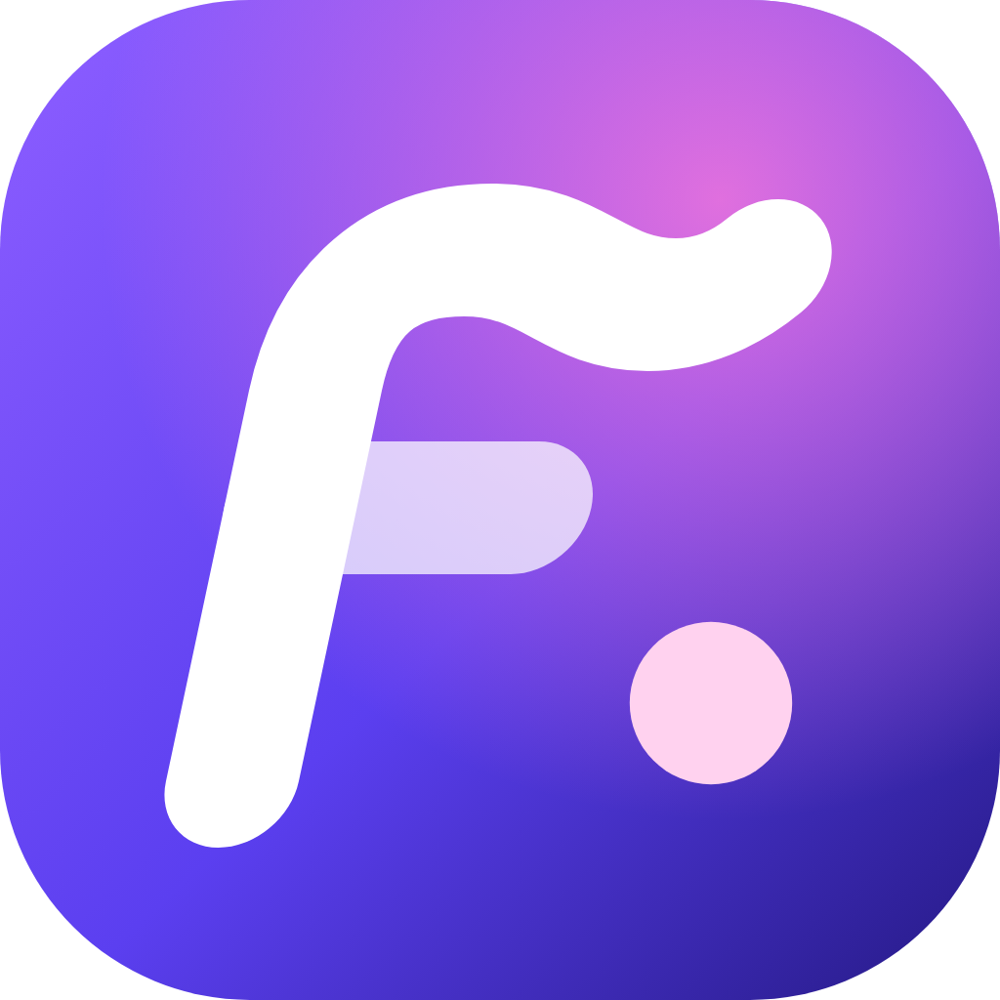

<p align="center">
  
</p>

<h1 align="center">InfluenceFlow CRM</h1>

<p align="center">
  <strong>Free, open-source CRM for influencer agencies & freelancers.</strong><br />
  Stop juggling Notion + Sheets + Gmail. Manage influencers, brands, campaigns & calendar — in one private workspace.<br />
</p>

<p align="center">
  <a href="https://dhurimhalili.github.io/influenceflow-crm/#/signup"><strong>→ Create free account (30s)</strong></a> ·
  <a href="https://dhurimhalili.github.io/influenceflow-crm/#/app">Live app</a> ·
  <a href="https://dhurimhalili.github.io/influenceflow-crm/home.html">About</a> ·
  <a href="#-do-i-need-my-own-supabase">Supabase FAQ</a>
</p>

<p align="center">
  
  
  
</p>

---

## Use it in 30 seconds — no setup

**You do NOT need your own Supabase. Just sign up.**

1. Go to **[Sign up free](https://dhurimhalili.github.io/influenceflow-crm/#/signup)** → create account
2. Add influencers manually, or **Bulk import** (`Name, channelUrl` paste or CSV file)
3. Track them: `New → Contacted → Replied → Negotiating → Roster → Signed` (plus `Inbound` for people who reached out to you, and `Denied` / `No reply`), table, Kanban board or cards
4. Create campaigns and schedule meetings in Calendar

That's it. Your data is private to your account — other users can't see it. Export anytime (Excel, CSV, JSON, copy-as-table or PDF).

> **Do I need my own Supabase?** No — for regular use. The live app already runs on a hosted Supabase (by the maintainer). You only need your own Supabase if you **fork the repo and want to self-host** your own copy. See [Self-host (for developers)](#-self-host-for-developers) below.

---

## How it works (3 steps)

| Step | What you do | What InfluenceFlow does |
|------|-------------|------------------------|
| **1. Organize** | Add influencers and brands manually or via bulk import | Keeps pipeline clean — dedupes, merges duplicates, soft-deletes to trash |
| **2. Close** | Create a **Campaign** linking Brand + Influencers | Calculates agency cut, warns if influencer+brand already linked, moves influencers to **Roster** |
| **3. Stay on top** | Add **Calendar** meetings linked to influencer/brand/campaign | Browser reminders so follow-ups don't slip |

---

## What's inside today

| Area | How you'd explain it to a teammate |
|------|-------------------------------------|
| **Influencers CRM** | Table + Kanban board + mobile cards. Filter (incl. country and "follow-up due"), sort by country, quick-filter chips, bulk-change status, bulk-delete, merge duplicates by name, personal notes per influencer |
| **Deal models** | Every common way brands pay: flat, flat + view guarantee, CPM with a counting window (e.g. 30 days), cap and minimum, hybrid base + CPM / per-sale / % of sales, base + view bonuses, CPA, revenue share, CPI, CPL, CPC, retainer, usage rights, whitelisting/Spark Ads, UGC, gifted. Brand revenue, your profit and the low/high range are computed from the terms; risk is flagged when performance pay could fall below creator fees |
| **Negotiation** | Each rate keeps the creator's list price. Negotiate the integration and the dedicated follows by the same % (marked "auto"); negotiate both and each takes its agreed price; everything else stays. One-click "apply the same % to…", full price history with undo. Prices creators send or agree to by email apply themselves — read by strict rules with no AI (and by the AI when it is on); older mail never overwrites a price you typed |
| **Media kits & proof** | PDFs / images influencers email you (media kits, rate cards, stats screenshots) are saved to private storage (10 MB/file, 300 MB/user, real file type checked) and downloadable; 10–25 MB files stay in Gmail (no storage used) and Canva / Drive / Dropbox kit links are saved too. Older emails are gone through once, roster first, and "Check emails" re-checks one creator. With AI reading on they're verified as that creator's kit and read: audience from files is "Verified"; numbers only typed in emails are "Their words" with a caution. Public media kits show only verified audience and list prices |
| **Money** | Invoices per campaign, chased on the follow-up schedule (business day after due, then each follow-up gap) with a ready reminder email; a contract drafted from the deal terms (fee formula, counting window, usage rights, exclusivity) — editable, printable |
| **Pitch PDF** | Tick creators → "Pitch PDF": a brand-ready shortlist with verified audience only and your marked-up prices (never their cost) |
| **Insights** | Reply speed per creator, best day/time to email (from your own sent mail), and each creator's CPM vs similar creators in your CRM |
| **Team** | Opt-in leaderboard: teammates see each other's daily outreach count (computed on the server) and name — nothing else from anyone's CRM |
| **Coach** | Daily outreach goal (default 50), a personalised challenge based on what you sent, follow-ups that slipped past your rules and replies you owe; a progress ring, a nudge when you open the CRM or come back, and a silent green celebration when you hit the goal |
| **Inbound leads** | An `Inbound` status for brands and creators who contacted you (website form, DM, email). Their arrival date is kept, the dashboard lists them longest-waiting first, and replying moves them to Replied |
| **Second email** | Optional second address per influencer and brand with a label (Manager, Agent, Brand manager…). The composer can send to either or CC both |
| **Follow-up log** | Every follow-up with its exact date and "N days ago", days quiet since last touch, "follow-up due" after 5 quiet days, undo the last one or remove any single one |
| **Socials** | Every influencer can have Instagram, TikTok, YouTube, X, Twitch, Kick, LinkedIn, Facebook, Snapchat, Pinterest, Threads and website links with follower counts. Paste a link-in-bio into **Quick fill** to add them all at once; ★ marks the main channel. Search by `@handle`, filter by any network, dedupe on any profile, CSV import/export columns per network |
| **Brand briefs** | Capture what every brand wants: creator niches, platforms, creator size (nano → mega), content formats, budget range + period, payment terms, usage rights, exclusivity, gifting, goals, markets, audience age/gender and what to avoid — in folded, chip-based sections. The profile shows the brief at a glance with a completeness ring, and **Best-fit creators** ranks your influencers against it (with reasons) so you can start a campaign in one click; each influencer profile shows the brands looking for them. Filter/sort brands by budget, wanted platform and niche; CSV import/export includes every brief field |
| **Brands & contacts** | Each brand has its own people (first/last name, title, email, LinkedIn). Same pipeline statuses |
| **Bulk import** | Paste `Rory Alexander, https://youtube.com/channel/UC...` or `Name, email, niche` — or **Attach CSV**. Auto-dedupes by name + link |
| **Campaigns** | Edit name, brand, platform, dates and deliverables any time. Two deal models: **fixed fee + markup** (default — lock the creator at e.g. 2,000, pitch the brand 5,000, keep 3,000; per-creator fees filled from their rate card, "pitch at 40% margin" suggestions) or **percentage split**. Live split bar, margin and markup, editable after creation. Status, dates, deliverables, assignments, conflict warning |
| **Calendar** | Month / week / day / agenda views. Meetings, tasks (check off), reminders, every influencer & brand **action due date** and campaign start/due dates on one timeline. Drag to reschedule, overdue panel, reminder presets, browser alerts, `.ics` export |
| **Gmail sync** | Connect one or several mailboxes (up to 5): emails to and from your influencers, brands and brand contacts show up on their profile, move the pipeline (email → Contacted, reply → Replied, they write first → Inbound) and drive follow-up flags. Send and follow up from the CRM in the same Gmail thread. Your hand-set status always wins until a newer email arrives; Negotiating, Roster, Signed and Denied are never changed for you. Only metadata (who, when, subject, Gmail's short preview) for CRM contacts is stored. Per-mailbox stats show which address sends the most and gets the most replies. Google tokens are encrypted at rest (AES-256-GCM, key in Vault) and the connect flow uses a one-time state + PKCE |
| **Deal models** | Every common way brands pay: flat, flat + view guarantee, CPM with a counting window (e.g. 30 days), cap and minimum, hybrid base + CPM / per-sale / % of sales, base + view bonuses, CPA, revenue share, CPI, CPL, CPC, retainer, usage rights, whitelisting/Spark Ads, UGC, gifted. Brand revenue, your profit and the low/high range are computed from the terms; risk is flagged when performance pay could fall below creator fees |
| **Negotiation** | Each rate keeps the creator's list price. Negotiate the integration and the dedicated follows by the same % (marked "auto"); negotiate both and each takes its agreed price; everything else stays. One-click "apply the same % to…", full price history with undo. Prices creators send or agree to by email apply themselves — read by strict rules with no AI (and by the AI when it is on); older mail never overwrites a price you typed |
| **Media kits & proof** | PDFs / images influencers email you (media kits, rate cards, stats screenshots) are saved to private storage (10 MB/file, 300 MB/user, real file type checked) and downloadable; 10–25 MB files stay in Gmail (no storage used) and Canva / Drive / Dropbox kit links are saved too. Older emails are gone through once, roster first, and "Check emails" re-checks one creator. With AI reading on they're verified as that creator's kit and read: audience from files is "Verified"; numbers only typed in emails are "Their words" with a caution. Public media kits show only verified audience and list prices |
| **Money** | Invoices per campaign, chased on the follow-up schedule (business day after due, then each follow-up gap) with a ready reminder email; a contract drafted from the deal terms (fee formula, counting window, usage rights, exclusivity) — editable, printable |
| **Pitch PDF** | Tick creators → "Pitch PDF": a brand-ready shortlist with verified audience only and your marked-up prices (never their cost) |
| **Insights** | Reply speed per creator, best day/time to email (from your own sent mail), and each creator's CPM vs similar creators in your CRM |
| **Team** | Opt-in leaderboard: teammates see each other's daily outreach count (computed on the server) and name — nothing else from anyone's CRM |
| **Coach** | Daily outreach goal (default 50), a personalised challenge based on what you sent, follow-ups that slipped past your rules and replies you owe; a progress ring, a nudge when you open the CRM or come back, and a silent green celebration when you hit the goal |
| **Inbound leads** | The Gmail scanner spots brands and creators who email you first and aren't in the CRM yet — newsletters, bulk mail, auto-replies, warm-up traffic, vendor/SEO pitches and personal mail are filtered out. Each suggestion says why it was picked; one click adds it as an Inbound brand or influencer |
| **Follow-up engine** | Yellow flag after one business day without a reply (email Monday → follow up Wednesday), stays until you follow up or they reply; "Reply needed" when they wrote last. Cadence per follow-up, working days, holidays and a stop limit in Settings → Follow-up rules. Log DMs, calls and WhatsApp replies by hand. Filters, quick chips, dashboard, calendar and sidebar badges |
| **Reports** | Reply rate, typical reply time in business days, which follow-up gets the replies, revenue and profit by month, best brands, reply rate by niche and country |
| **Media kits** | One click publishes a clean public page for a creator (socials, reach, engagement, optional rates and contact button) to send brands — an unguessable link you can update or take offline; Save as PDF |
| **Email drafts** | Brands: a compact card on each profile that opens into a large focused composer. Per-influencer and per-brand subject + body that autosave, reusable templates with `{first_name}` / `{niche}` / `{company}` tokens, open in Gmail or your mail app, "mark as sent" moves the lead to Contacted |
| **Creator scorecard** | Four manual star ratings — audience quality, niche & brand fit, engagement quality, posting consistency — combined with agency-scorecard weights (35 / 30 / 20 / 15, adjustable in Settings). Engagement rate is shown as a benchmark, never sets the stars |
| **Billing** | Per-campaign invoice tracking (Unpaid → Invoiced → Paid, invoice due date on the calendar, overdue alerts) and creator payout status; "Outstanding invoices" on the dashboard |
| **Rate cards** | Every way a sponsorship is sold: integrated video, dedicated video, short, post, carousel, stories, stream, podcast read, UGC — plus add-ons (link in bio, usage rights, exclusivity). CPM from average views |
| **Account & settings** | Account menu with sign out, sign out & clear device, sign out everywhere; profile, agency name & email signature; currency (USD / EUR / GBP / CHF / CAD / AUD); default creator payout %; start page; notifications with daily action summary; keyboard shortcuts (`?`) |
| **Pipeline hygiene** | Contact date stamps itself the moment a lead leaves New (table, kanban, cards, bulk or profile); offline-safe sync that never lets an older cloud copy overwrite your edits |
| **Bulk & sharing** | Tick influencers to log a follow-up for all of them or copy their emails for a BCC send; "Copy pitch" turns a profile into a ready-to-paste summary for brands (socials, reach, rates with CPM) |
| **Exports** | "Everything in Excel" in Settings (one sheet per record type), real Excel workbooks (.xlsx — frozen header, filters, numbers and dates as real values; opens the same in Excel desktop/web, Google Sheets, Numbers), CSV, CSV for European Excel, JSON, **copy as table** (pastes into Google Docs, Word, Sheets, Notion) and **print / PDF**. Column presets such as a brand-safe pitch sheet. Re-importable |
| **Always up to date** | Opening the app jumps straight to the newest release, and open tabs install a new release within seconds of it going live — as soon as you stop typing, with your work saved first. Settings → App version shows which build a device runs. Installable to the home screen (fixed PWA manifest + app icons) |
| **Data & privacy** | Per-user Supabase Auth + RLS (no one sees your data), global search, JSON backup export/import (v2 + legacy), Deleted list, activity log |
| **Polish** | Agency (default), Light, Dark, Honey, Ocean themes, fully responsive, larger readable type scale |

> Note: legacy discovery/outreach edge functions remain under `supabase/functions/` but are not wired to the UI.

---

## ❓ Do I need my own Supabase?

**Short answer: No.**

| You want to... | Do you need Supabase? |
|----------------|-----------------------|
| **Just use the CRM** at `dhurimhalili.github.io/influenceflow-crm` | **No.** Sign up and go. Database, auth and RLS — already hosted. |
| **Run it locally** or **deploy your own copy** (fork) | **Yes.** Clone the repo, create a free Supabase project, apply the `supabase/migrations/*.sql` files, set `VITE_SUPABASE_URL` / `VITE_SUPABASE_ANON_KEY`. Details below. |

---

## Self-host (for developers)

Only follow this if you're forking / running your own instance. Regular users skip it.

<details>
<summary><strong>Local dev — 3 commands</strong></summary>

```powershell
cd web
copy .env.example .env
# edit .env → set VITE_SUPABASE_URL and VITE_SUPABASE_ANON_KEY from your Supabase project
npm install
npm run dev
# open http://localhost:5173
```

</details>

<details>
<summary><strong>Your Supabase project — one-time setup</strong></summary>

1. Create a project at [supabase.com](https://supabase.com) (free tier is fine).
2. In **SQL Editor**, run the files in `supabase/migrations/` in timestamp order (starting with the `20200101` bootstrap — it creates the core tables, RLS and policies). They create core CRM tables, RLS policies, and auto-seed for new users.
3. In **Auth → URL Configuration**, set the Site URL to your app URL and add your app URL + `#/update-password` to **Redirect URLs** (password recovery links must be allow-listed).
4. In **Auth → Emails → SMTP Settings**, connect your own SMTP provider (Resend, Postmark, Brevo, Gmail app password…). Supabase's built-in sender only delivers to your own team's addresses and ~2 emails per hour, so password-reset emails to your users silently never arrive without it.

</details>

<details>
<summary><strong>Gmail sync (optional)</strong></summary>

1. In Google Cloud Console create an OAuth client (Web application), enable the **Gmail API**, and add the redirect URI `https://<project>.supabase.co/functions/v1/gmail-oauth-callback`.
2. OAuth consent screen scopes: `gmail.readonly`, `gmail.send`, `openid`, `email`. While the app is in *Testing*, add each user as a test user (Google expires testing refresh tokens after 7 days); for everyone, submit the app for Google verification (restricted scopes).
3. Supabase → Edge Functions → Secrets: `GOOGLE_CLIENT_ID`, `GOOGLE_CLIENT_SECRET`, `GMAIL_OAUTH_REDIRECT_URI` (the URI above), `APP_URL` (your app URL).
4. Deploy `gmail-oauth-start` (JWT verified), `gmail-sync` and `gmail-oauth-callback` (both `--no-verify-jwt`: they authenticate themselves — a user JWT or the Vault cron secret, and a one-time OAuth state).
5. Tokens are encrypted with a key the migration generates in Vault (`gmail_token_key`); nothing to configure.
6. Background sync: the migration generates the cron secret inside Vault and schedules the job every 10 minutes. Tell it where the function lives, once: `select vault.create_secret('https://<project>.supabase.co/functions/v1/gmail-sync', 'gmail_sync_url');`
7. Optional AI reading (media kits, screenshots, prices in emails): add a `GEMINI_API_KEYS` secret (one or more keys, comma separated — default model `gemini-3.8-flash`, override with `GEMINI_MODEL`) or an `ANTHROPIC_API_KEY` (Claude; also double-checks inbound leads). When a Gemini key hits its quota the next key is used with the same model; when all are out, files wait in a queue. Free-tier Gemini quota is per Google Cloud project, and free-tier data may be used by Google to improve its products. Capped at 150 AI calls per user per day; email bodies are read in memory and never stored.
8. Lead scanner tests: `node --experimental-strip-types supabase/functions/_shared/leadScanner.test.ts`.
9. Negotiation tests: `node --experimental-strip-types supabase/functions/_shared/negotiation.test.ts`.
10. Going public (Google verification): see [docs/google-verification.md](docs/google-verification.md).

</details>

<details>
<summary><strong>Deploy to GitHub Pages</strong></summary>

Push to `main` — the workflow in `.github/workflows/deploy-pages.yml` builds `web/` and deploys automatically. It reads `VITE_SUPABASE_URL` / `VITE_SUPABASE_ANON_KEY` from **repo Settings → Secrets and variables → Actions** (never commit keys — set them as secrets in your fork too).

</details>

---

## Project layout

```text
influenceflow-crm/
├── web/                 ← Vite + React 19 + TypeScript app (source of truth)
│   ├── src/pages/       ← Influencers, Brands, Campaigns, Calendar, Settings ...
│   ├── src/components/  ← AppShell, ui kit
│   ├── src/contexts/    ← Auth, workspace data, toasts
│   ├── src/services/    ← Supabase sync (lossless load/persist)
│   ├── src/types/       ← workspace data model
│   ├── src/lib/         ← supabase client, utils, seed
│   └── public/          ← home.html copy etc.
├── supabase/
│   ├── migrations/      ← Postgres + RLS tables (for self-host)
│   └── functions/       ← backend functions (hidden modules preserved)
├── home.html            ← public marketing page
├── privacy.html / terms.html
├── LICENSE              ← MIT
└── README.md
```

**Stack:** React 19 · TypeScript · Vite · React Router · Supabase (Postgres + Auth + RLS)

---

## Roadmap

- **Done:** Influencers (table/kanban/cards), Brands + people, Campaigns + calendar, bulk import/export, follow-up tracking, true deal-loss tracking, outreach momentum stats (daily → 90 days), email drafts + templates, weighted creator scorecard, action due dates on the calendar, password recovery, notes, backup
- **Next:** Tighter calendar reminders, better analytics, team workspaces (optional)
- Track in [Issues](https://github.com/DhurimHalili/influenceflow-crm/issues) · ideas and PRs welcome

---

## Contributing

See [CONTRIBUTING.md](CONTRIBUTING.md). Bug reports, ideas, and PRs are welcome.

---

## License

[MIT](LICENSE) © Dhurim Halili

---

## Contact

- Portfolio: [concepts-ew8.pages.dev](https://concepts-ew8.pages.dev/)
- LinkedIn: [dhurim-halili](https://www.linkedin.com/in/dhurim-halili-9183b81a0/)
- WhatsApp: [+383 49 878 908](https://wa.me/38349878908)
